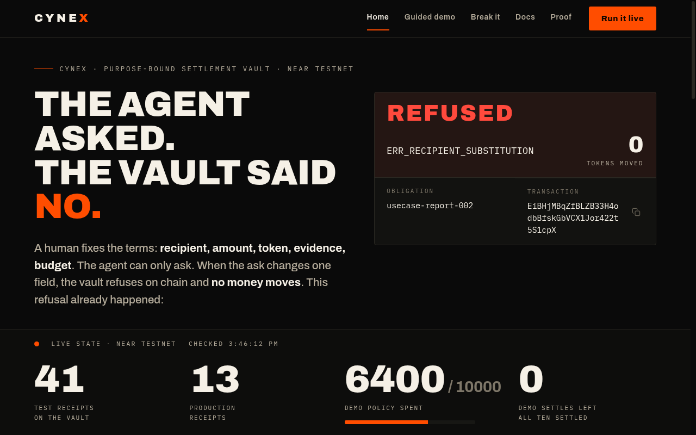
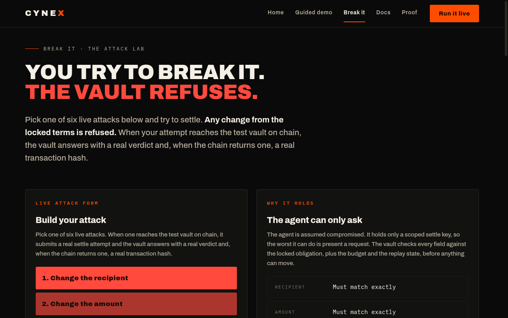
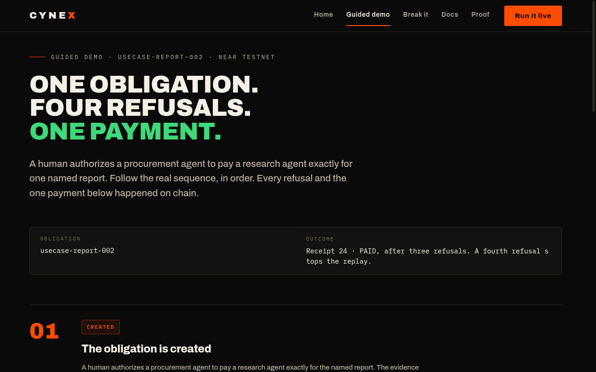
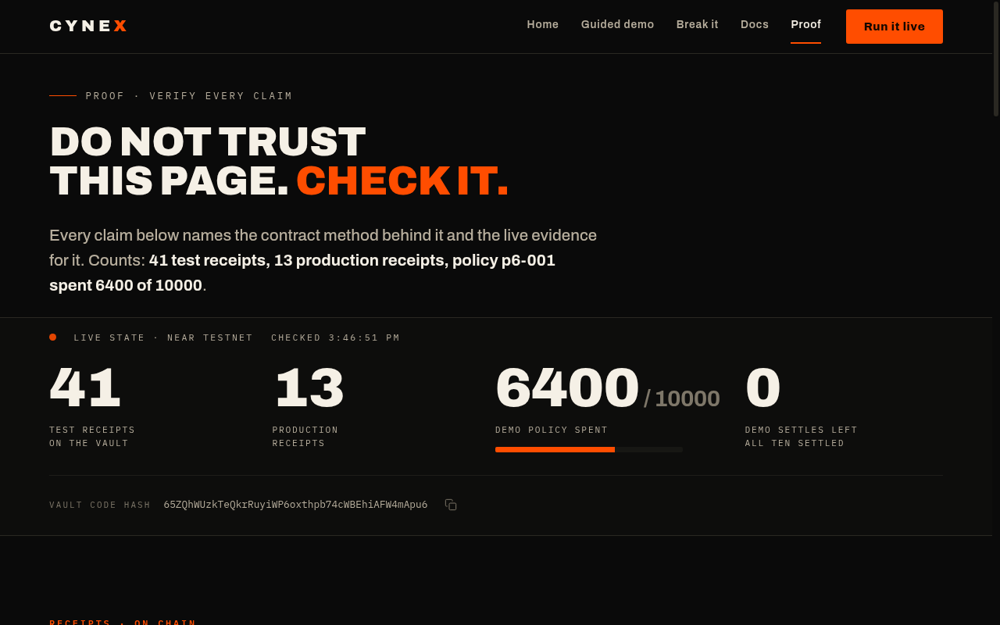

# Cynex

**Pay the obligation. Not the prompt.**

AI agents now hold wallets and spend money, but a compromised prompt has already drained an agent wallet, because no universal on-chain check ensures a payment matches exactly what the human authorized.

Cynex is a purpose-bound settlement vault for AI agents on NEAR. A human authorizes one exact payment, recipient, token, amount, evidence, and budget fixed in advance. The agent may ask for settlement, but the vault pays only that payment and refuses everything else. The agent is assumed compromised. It holds a key that can only call `settle`, and the vault, not the agent, decides whether the money moves.



## Live proof, right now

Both vaults run code hash `65ZQhWUzkTeQkrRuyiWP6oxthpb74cWBEhiAFW4mApu6`. Testnet throughout, fake testnet USDC with no value.

| | Test vault | Production vault |
|---|---|---|
| Receipts | 41 | 13 |
| Policy | p6-001, spent 6400 of 10000 | p5-prod-001, spent 500 of 1000 |
| Agent balance | 2700 test USDC | |

Four TEE executions carry independently verified TDX attestations. The token is `usdc.fakes.testnet` (USDC.e, 6 decimals).

## Judges, start here

Sixty seconds, no wallet, no account, no install.

**01, 10 seconds. Run it live.** The 10 demo settles are used up. Do: press the button on Home. See: the used-up fallback, pointing to the sandbox demo and the MCP demo. The last live settle, receipt 40 (demo-live-010), is PAID, settled 13 Nov 2026; NearBlocks tx B1sgPrTwzaBrEJYMQrKW3ikxiFXxAH7f5E4jCdKA4ggo, block 277475027.

**02, 15 seconds. Try to break it.** Open Break it and change the recipient. Do: submit a tampered settle. See: refused, `ERR_RECIPIENT_SUBSTITUTION`, 0 tokens moved, with the real refusal transaction hash when one comes back.



**03, 30 to 60 seconds. Verify on chain.** Run one command from the repo root. Do: `node frontend/dist-test/cli/cynex.js verify-live cynex-testvault.cynexmaster.testnet`. See: every row `verified_ok = true`, 41 receipts, all ok.

## What is real and what is simulated

| | Real | Simulated |
|---|---|---|
| The vault | Real contract on NEAR testnet, both vaults | Nothing |
| A refusal | Real on-chain refusal, 0 tokens moved, transaction hash when one comes back | Nothing |
| A settle | Real on-chain settle, real receipt, real tx hash | Nothing |
| The TEE quote | Real TDX quote, independently verifiable offline | Nothing |
| The MCP sandbox demo | Real vault and token contracts on a local chain | Nothing mocked |
| The attack panel on Break it | For attempts it submits, the form shows the vault's verdict and the transaction hash when one comes back. Some attempts are refused by the handler before submission, including missing obligations, wrong state, or an exhausted demo pool; those have no transaction. | Nothing (pre-submit guards read live chain state and skip tx submission) |

## Try it yourself

**Hosted demo:** [https://cynex-nine.vercel.app](https://cynex-nine.vercel.app). No login, no wallet, no install. Walk the live chain, try to break it, verify every receipt.

**Local demo, one command.** Run the real vault in a sandbox on your machine, nothing mocked, nothing touches testnet:

```sh
npx cynex-mcp --sandbox
```

That starts a local near-sandbox with the real vault and token contracts, seeds five obligations, and serves the real MCP server over stdio. Or clone the repo and run `cd frontend && npm run mcp:build && npm run mcp:demo`.

## How it works

**1. Authorize.** The owner creates an obligation: recipient, token, amount, evidence type, evidence hash, expiry, and a one-time nonce. The obligation starts CREATED.

**2. Prove.** Evidence is verified. A pass moves the obligation to READY. A block moves it to BLOCKED. A warn needs the owner's explicit approval.

**3. Settle.** The agent settles with its scoped key. The vault checks the recipient, the amount, the nonce, and the budget, then pays through the token contract and writes a receipt chained to the previous receipt hash.



Three layers prove a payment is right, and no layer trusts another. Layer 1, on-chain integrity: for evidence up to 64 KiB, the vault hashes the bytes itself with SHA-256 and compares them to the digest committed at authorization. Layer 2, TEE provenance: a guest program fetches the evidence inside an Intel TDX enclave and hashes it there, and the per-execution TDX quote binds what ran, what went in, and what came out. Layer 3, VRF anchor: the guest requests VRF randomness and the vault verifies the signature on chain, bound to the pending request.

The agent's key is scoped to one contract and one method, `settle`. It cannot transfer NEAR, add keys, or call any owner method. That scope is enforced twice: by the key itself on chain, and by the agent wrapper, which refuses to build any call other than settle before it ever reaches a signer.

The frozen API, digest format, timeouts, and all eleven settle reason codes are in `docs/contract-api.md`. The threat model is in `docs/threat-model.md`.

## The proof



The vault refuses bad terms on chain. Four refusals, then the correct settle, all on the test vault, all with real transaction hashes. Receipt 24, `usecase-report-002`, is the canonical run.

| Check | What was wrong | Error code | Evidence |
|---|---|---|---|
| Evidence missing | Settle called before evidence was submitted | ERR_INVALID_STATE | BRXXhezV...gwpCgQ, 0 tokens moved |
| Recipient changed | Proposed recipient did not match the authorized recipient | ERR_RECIPIENT_SUBSTITUTION | EiBHjMBq...5S1cpX, 0 tokens moved |
| Amount changed | Proposed 200 base units, authorized 100 | ERR_TERMS_MISMATCH | 2NaWqCYi...Eer91f, 0 tokens moved |
| Replay | Same nonce reused after the order was paid | ERR_NONCE_ALREADY_CONSUMED | hG6uhpeP...pP91F6, 0 tokens moved |

The recipient balance read before and after each call was identical, so nothing moved. The attack transcript is in `docs/use-case-demo-script.md`. The full demo script is in `docs/demo-script.md` and the proof record is in `docs/demo-proof.md`.

**Verify the TEE attestation yourself.** Every TEE execution behind the live proofs has a published attestation you can fetch and verify, with no account, no key, and no trust in us. Install the verifier once, then run:

```sh
cargo install --git https://github.com/out-layer/outlayer-verify outlayer-verify
scripts/verify-tee-attestation.sh --bundle docs/attestation-proofs/attestation-proof-10640.json
```

It prints PASS with exit 0. The four executions are requests 10640, 11912, 13040 (test vault) and 13324 (production vault, obligation `prod-tee-001`, receipt 11). Each bundle verifies offline. The VRF signature proves the output was not re-rolled and binds it to the pending request. It does not prove a TEE executed the guest, and we do not claim it does. The TDX quote is what proves the guest ran inside a genuine enclave, and the vault does not verify the quote on chain, by design, because on-chain TDX verification is infeasible on NEAR. So the quote is verified off chain, and the proof is shipped in this repo.

**The reputation check.** Before the agent settles, the console checks the recipient against five sourced signals: the account exists on chain and its current code hash, the account age, prior interactions with this vault from the receipts, a shared blocklist when one is configured, and whether the receiver's contract code changed recently. The answer is ALLOW, WARN, or BLOCK, with reasons. BLOCK refuses outright. WARN goes to the owner and never settles silently. The full spec is in `docs/reputation-engine.md`.

## Honest limits

- The production recipient used in the early demos, `acme-supplies.testnet`, does not exist on chain. The token contract still credits it, because `ft_transfer` only updates the token's own ledger, but no account stands behind those tokens. Do not demo a settle to it. Use a recipient account that exists.
- Evidence over 64 KiB cannot use the on-chain check and falls back to TRUSTED_RELAYER, which is trusted by label, never presented as trustless.
- The on-chain check proves the bytes match the commitment. It does not prove the bytes mean what their source claims. That judgment belongs to the human at authorization time.
- No suitable shared blocklist for NEAR account ids was found, so the blocklist signal is unavailable unless a URL is configured. The BLOCK path is proven by tests with a fixture URL, not by a live list. The provenance record is in `demo/reputation-blocklist-provenance.json`.
- The VRF signature does not prove TEE execution. The vault does not verify the TDX quote on chain. Verification is off chain, not part of the contract check.

## Reproduce it

Do X, see Y. These commands were run from a fresh clone, and the expected result is what the run printed. Rust 1.93.0 and cargo-near must already be installed.

**1. Contract.** From `contract/`. See 142 passed, 0 failed, a clean clippy with no warnings, and a built wasm binary:

```sh
RUSTUP_TOOLCHAIN=1.93.0 cargo test --lib
RUSTUP_TOOLCHAIN=1.93.0 cargo clippy --all-targets -- -D warnings
RUSTUP_TOOLCHAIN=1.93.0 cargo near build non-reproducible-wasm
```

**2. Frontend and services.** From `frontend/`. See 655 tests passed, 3 skipped, 658 total:

```sh
npm install
npm run typecheck
NODE_PATH=$PWD/node_modules npm run jest
```

**3. Verify a TEE attestation offline.** From the repo root. See PASS with exit 0:

```sh
scripts/verify-tee-attestation.sh --bundle docs/attestation-proofs/attestation-proof-10640.json
```

**4. Verify the live testnet record.** From the repo root. See a CSV of receipts, 41 rows on the test vault and 13 on the production vault, every row `verified_ok=true`, exit 0. This reads chain state only and spends nothing:

```sh
node frontend/dist-test/cli/cynex.js verify-live cynex-testvault.cynexmaster.testnet
node frontend/dist-test/cli/cynex.js verify-live cynex-vault.cynexmaster.testnet
```

**5. Attack dry run.** From the repo root. See four DRY-RUN lines, one per scenario, each with the code it expects, and no transaction sent:

```sh
node frontend/dist-test/cli/cynex.js attack cynex-testvault.cynexmaster.testnet demo/attack-scenarios.json --dry-run
```

The full demo run is separate: it creates obligations and settles with real keys. The console needs the environment in `.env.example`. Key files hold a bare key string, never a JSON credential file, and are never printed or committed. The vault and the recipient must be storage-registered on the token and the policy funded before a live run.

## Keys

The hosted site holds one key server-side, and only one: a fresh scoped settle-only key for the Run it live and Break it buttons, stored as a Vercel environment variable, scoped to `settle` on the test vault only (`cynex-testvault.cynexmaster.testnet`), initial allowance 1 NEAR, testnet only, low value. It can only attempt settles; the vault decides. The hosted site never holds the existing executor key, the owner key, or any full-access key, and never offers a generic settlement endpoint.

## Docs

- `docs/contract-api.md`, the frozen API, digest, timeouts, reason codes
- `docs/ledger.md`, the signed build ledger
- `docs/threat-model.md`, what the vault assumes and what it does not
- `docs/spike-outlayer.md`, the OutLayer spike report and verdict
- `docs/attack-transcript.md`, historical attack demo log
- `docs/reputation-engine.md`, the reputation engine
- `docs/deployment.md`, where the vaults are deployed and how to verify them

